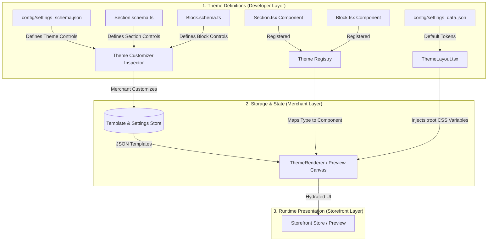

# Shopiti Theme Engine — Master Architecture Specification

> **A comprehensive, enterprise-grade specification for building, organizing, and scaling schema-driven React storefront themes.**  
> Inspired by the proven architecture of **Shopify Online Store 2.0 (Dawn / Horizon)**, engineered natively for **React 19, TypeScript, and Emotion**.

---

## 1. Executive Summary & Core Philosophy

The **Shopiti Theme Engine** bridges the gap between modern React web application architecture and merchant-friendly, schema-driven e-commerce platforms.

In traditional Shopify development, merchants customize pages through a visual customizer powered by server-rendered `.liquid` templates containing embedded `` JSON blocks. In the Shopiti headless engine:

- **Sections & Blocks** are written as strictly typed, pure **React Components** (`.tsx`).
- **Schemas** are colocated TypeScript/Zod definitions (`.schema.ts`) that define merchant controls, default values, limits, and presets.
- **Templates & Configurations** are stored as pure, serialized **JSON data** (`templates/*.json`, `config/settings_data.json`), completely decoupled from presentation logic.
- **The Theme Customizer** dynamically parses schemas at runtime, auto-generating visual inspector controls with real-time bidirectional state synchronization and instant hot re-rendering.



---

## 2. Directory Structure Specification

Every theme in the Shopiti ecosystem is completely self-contained within `themes/[theme-id]/`. The structure mirrors Shopify Online Store 2.0 with React idioms:

```text
themes/
├── shared/                                 # Global engine contracts & shared utilities
│   ├── types/
│   │   └── theme.ts                        # Master TypeScript schemas & contracts
│   ├── utils/
│   │   ├── colors.ts                       # Color scheme CSS variable generator
│   │   └── typography.ts                   # Font loading and calculation helpers
│   ├── media/                              # Media URL resolution & responsive helpers
│   └── navigation/                         # Link resolution & safe route helpers
│
├── active.ts                               # Active theme adapter for the storefront/editor
├── registry.ts                             # Global registry of all installed themes
├── index.ts                                # Public entrypoint (#themes import target)
│
├── dawn/                                   # Production Theme Package #1 (B2C / Commerce)
│   ├── assets/                             # Theme-specific icons, SVGs, static assets
│   ├── config/
│   │   ├── settings_schema.json            # Global settings inspector definitions
│   │   └── settings_data.json              # Active global theme tokens & presets
│   ├── layout/
│   │   └── ThemeLayout.tsx                 # Master layout shell & :root CSS variable injector
│   ├── sections/                           # Merchant-facing page sections
│   │   ├── header/                         # Section folder
│   │   │   ├── Header.tsx                  # Presentation component
│   │   │   ├── Header.schema.ts            # Section schema & presets
│   │   │   └── index.ts                    # Public export
│   │   ├── footer/
│   │   ├── hero-banner/
│   │   ├── featured-collection/
│   │   └── ...
│   ├── blocks/                             # Child blocks nested inside sections
│   │   ├── announcement/                   # Block folder
│   │   │   ├── AnnouncementBlock.tsx
│   │   │   ├── AnnouncementBlock.schema.ts
│   │   │   └── index.ts
│   │   ├── button/
│   │   ├── heading/
│   │   └── ...
│   ├── snippets/                           # Developer-only UI helpers (NO schemas)
│   │   ├── price/
│   │   ├── badge/
│   │   └── product-card/
│   ├── templates/                          # Pure JSON page templates
│   │   ├── index.json                      # Homepage template
│   │   ├── product.json                    # Default product template
│   │   ├── collection.json                 # Default collection template
│   │   ├── page.json                       # Default static page template
│   │   ├── page.about.json                 # Alternate about page
│   │   ├── page.contact.json               # Alternate contact page
│   │   ├── 404.json                        # Error page template
│   │   └── catalog.ts                      # Template index catalog
│   ├── registry.ts                         # Theme-level Section & Block registry
│   └── index.ts                            # ThemeDefinition export
│
└── forge/                                  # Production Theme Package #2 (B2B / Industrial)
    ├── config/
    ├── layout/
    ├── sections/
    ├── blocks/
    ├── snippets/
    ├── templates/
    ├── registry.ts
    └── index.ts
```

---

## 3. Core Architectural Distinctions Matrix

To prevent code degradation as more themes are created, all components MUST strictly adhere to this role matrix:

| Architectural Layer | Location | Has Schema? | Customizer Visible? | Props / Data Source | Purpose & Example |
| :--- | :--- | :---: | :---: | :--- | :--- |
| **Master Layout** | `layout/ThemeLayout.tsx` | Global (`settings_schema.json`) | **YES** (Global Settings tab) | `globalSettings` | Wraps all pages, compiles `:root` CSS variables, slots Header & Footer groups. |
| **Section Groups** | `sections/*-group.json` or `layout/` | **YES** | **YES** (Global header/footer tree) | `SectionGroupData` | Persistent multi-section groups (e.g. Announcement + Header + MegaMenu) rendered across all pages. |
| **Sections** | `sections/[name]/` | **YES** (`[Name].schema.ts`) | **YES** (Reorderable in layer tree) | `SectionComponentProps<T>` from template JSON | Standalone high-level page modules (`HeroBanner`, `FeaturedCollection`, `ImageWithText`). |
| **Blocks** | `blocks/[name]/` | **YES** (`[Name].schema.ts`) | **YES** (Nested under parent section) | `BlockComponentProps<T>` from section `blocks` JSON | Atomic, swappable child elements (`Heading`, `Button`, `Slide`, `AccordionItem`). |
| **Snippets** | `snippets/[name]/` | **NO** (Strictly prohibited) | **NO** (Developer-facing only) | Pure React Props | Reusable UI rendering helpers (`Price`, `RatingBadge`, `QuantityInput`, `Icon`). |
| **Templates** | `templates/*.json` | Pure JSON Data | **YES** (Page dropdown selector) | Serialized state | Declares which sections render on a page, their instance settings, and block order. |

---

## 4. Documentation Suite Index

This master document provides a high-level overview. For comprehensive, exhaustive implementation guidelines, refer to the dedicated documentation modules:

1. **[Pages & Template Architecture](file:///home/framadhita/Documents/Projects/personal/shopiti/docs/pages-and-templates.md)**  
   *Deep dive into template hierarchy, JSON structure, route resolution, alternate templates (`page.about.json`), contextual data injection (Product/Collection models), and layout selection.*

2. **[Sections & Blocks Architecture](file:///home/framadhita/Documents/Projects/personal/shopiti/docs/sections-and-blocks.md)**  
   *Exhaustive specification of Section and Block schemas, editable attributes taxonomy (6 tiers), conditional visibility (`visible_if`), limits, container blocks, and lifecycle rendering.*

3. **[Header & Footer Architecture](file:///home/framadhita/Documents/Projects/personal/shopiti/docs/header-and-footer.md)**  
   *Section Groups architecture (`header-group.json`, `footer-group.json`), persistent layouts, sticky navigation, mega menus, announcement tickers, mobile drawers, and multi-column footers.*

4. **[Media & Image Management](file:///home/framadhita/Documents/Projects/personal/shopiti/docs/media-and-images.md)**  
   *Content management for images, reusable media library CMS, the `ImageValue` schema, focal point cropping, art direction, responsive `srcset`, and WebP/AVIF optimization.*

5. **[Links & Navigation System](file:///home/framadhita/Documents/Projects/personal/shopiti/docs/links-and-navigation.md)**  
   *The Omnibox Link Picker (`UrlValue`), internal route resolution, catalog handles, external URL protocols, anchor tags, navigation menus, and editor iframe click safety.*

6. **[Global Theme Settings Specification](file:///home/framadhita/Documents/Projects/personal/shopiti/docs/global-theme-settings.md)**  
   *The 13 global settings categories: 5-Scheme Color Matrix, Typography system, Layout & Grid dimensions, Buttons, Cards, Badges, Cart Drawer, and CSS variable compilation.*

7. **[Shopify-Inspired Advanced Patterns & Scaling](file:///home/framadhita/Documents/Projects/personal/shopiti/docs/shopify-advanced-patterns.md)**  
   *Section Presets, App Blocks / App Embeds, dynamic data bindings, CLI schema validation, and rules for scaling to 10+ themes without technical debt.*

---

## 5. Architectural Scaling Checklist (Preventing Tech Debt)

When creating Theme #3, #4, or #10, follow these strict architectural rules:

1. **Never Hardcode Hex Values or Fonts:** All colors must consume `--color-*` or `.color-scheme-*` CSS variables; all fonts must consume `--font-heading` or `--font-body`.
2. **Never Duplicate Shared Contracts:** Always import types and utilities from `#themes/shared/*`. Theme packages must remain leaf modules.
3. **No Cross-Theme Dependencies:** `themes/forge` MUST NEVER import from `themes/dawn`. Any code needed by both themes belongs in `themes/shared/` or `themes/snippets/`.
4. **Pure Data Templates:** `templates/*.json` must only contain IDs, types, and settings. No HTML or inline styling is permitted in template JSON.
5. **Always Provide Presets:** Every section must export at least one preset in its schema so merchants can immediately add it with working, beautifully styled default content.
