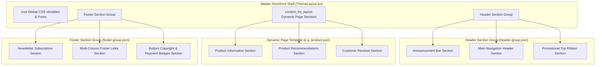

# Header & Footer Architecture

> **A Complete Guide to Global Navigation, Section Groups, Persistent Layouts, and Sticky Behaviors in Shopiti.**  
> Modeled after **Shopify Online Store 2.0 Section Groups (`header-group.json`, `footer-group.json`)**.

---

## 1. The Architectural Challenge: In-Page Sections vs. Section Groups

In early headless or naive theme engines, the Header and Footer are placed directly inside every page template's `sections` object (`templates/index.json`, `templates/product.json`, `templates/page.json`).

### Why this is an anti-pattern:

1. **Data Desynchronization:** If a merchant updates their store phone number or adds an Announcement Bar on the homepage, that change is only saved to `index.json`. The product and collection pages continue showing the old header!
2. **Template Duplication:** Every new page template requires copy-pasting 50+ lines of identical header and footer JSON.
3. **Naming Inconsistencies:** If Theme A calls its header `"header"` and Theme B calls it `"company-header"`, layout code breaks.

---

## 2. The Solution: Shopify Section Groups

In Shopify Online Store 2.0, Header and Footer are managed as **Section Groups**:

- Stored as dedicated JSON files: `sections/header-group.json` and `sections/footer-group.json` (or exported via `ThemeDefinition.headerGroup` and `ThemeDefinition.footerGroup`).
- Persistent across the entire storefront: A single global state applies to all pages.
- Multi-section capability: A header group isn't just one section—it can hold an Announcement Bar Section, a Main Header Section, and a Promotional Ribbon Section!



---

## 3. Section Group JSON Structure

### `sections/header-group.json`:

```json
{
  "name": "Header Group",
  "type": "header",
  "sections": {
    "announcement_bar": {
      "type": "announcement-bar",
      "settings": {
        "color_scheme": "scheme-3",
        "show_social_icons": true,
        "auto_rotate": true,
        "rotation_interval": 5
      },
      "block_order": ["announcement_1", "announcement_2"],
      "blocks": {
        "announcement_1": {
          "type": "announcement",
          "settings": {
            "text": "Free express shipping on all orders over $150",
            "link": "/collections/all"
          }
        },
        "announcement_2": {
          "type": "announcement",
          "settings": {
            "text": "✨ Summer Sale: Up to 40% off select essentials",
            "link": "/collections/sale"
          }
        }
      }
    },
    "main_header": {
      "type": "header",
      "settings": {
        "logo_position": "middle-left",
        "sticky_header_type": "on-scroll-up",
        "menu": "main-menu",
        "enable_mega_menu": true,
        "show_line_separator": true,
        "color_scheme": "scheme-1"
      }
    }
  },
  "order": ["announcement_bar", "main_header"]
}
```

### `sections/footer-group.json`:

```json
{
  "name": "Footer Group",
  "type": "footer",
  "sections": {
    "newsletter_signup": {
      "type": "newsletter-section",
      "settings": {
        "heading": "Join the Inner Circle",
        "subheading": "Subscribe for early access to drops and exclusive offers.",
        "color_scheme": "scheme-2"
      }
    },
    "main_footer": {
      "type": "footer",
      "settings": {
        "color_scheme": "scheme-3",
        "show_payment_icons": true,
        "show_currency_selector": true,
        "show_language_selector": true
      },
      "block_order": [
        "brand_bio",
        "quick_links",
        "customer_service",
        "social_block"
      ],
      "blocks": {
        "brand_bio": {
          "type": "brand_information",
          "settings": {
            "heading": "Shopiti",
            "bio": "Modern headless commerce engineered for performance."
          }
        },
        "quick_links": {
          "type": "link_list",
          "settings": { "heading": "Shop", "menu": "footer-shop-menu" }
        },
        "customer_service": {
          "type": "link_list",
          "settings": { "heading": "Support", "menu": "footer-support-menu" }
        },
        "social_block": {
          "type": "social_icons",
          "settings": { "heading": "Connect" }
        }
      }
    }
  },
  "order": ["newsletter_signup", "main_footer"]
}
```

---

## 4. Master Layout Integration (`ThemeLayout.tsx`)

The master layout component encapsulates the entire page shell, receiving the Header and Footer components as slots:

```tsx
import React from 'react'
import styled from '@emotion/styled'
import { Global, css } from '@emotion/react'
import type { ThemeLayoutProps } from '#themes/shared/types/theme'
import { generateColorSchemeCss } from '#themes/shared/utils/colors'

const PageContainer = styled.div`
  min-height: 100vh;
  display: flex;
  flex-direction: column;
  background-color: var(--color-background);
  color: var(--color-foreground);
`

const MainContent = styled.main`
  flex: 1;
  width: 100%;
`

export const ThemeLayout: React.FC<ThemeLayoutProps> = ({
  children,
  headerComponent,
  footerComponent,
  globalSettings,
}) => {
  return (
    <PageContainer>
      {/* 1. Inject Dynamic CSS Variables from settings_data.json into :root */}
      <Global
        styles={css`
          :root {
            --page-width: ${globalSettings?.current.page_width ?? 1280}px;
            --font-heading: ${globalSettings?.current.font_heading || "'Inter', sans-serif"};
            --font-body: ${globalSettings?.current.font_body || "'Inter', sans-serif"};
          }
          ${generateColorSchemeCss(globalSettings?.current.color_schemes)}
        `}
      />

      {/* 2. Global Header Section Group (Pinned at Top) */}
      {headerComponent}

      {/* 3. Page Body (Equivalent to {{ content_for_layout }}) */}
      <MainContent id="MainContent" tabIndex={-1}>
        {children}
      </MainContent>

      {/* 4. Global Footer Section Group (Pinned at Bottom) */}
      {footerComponent}
    </PageContainer>
  )
}
```

---

## 5. Header Capabilities & Editable Controls

A production-ready header section schema supports these merchant controls:

### 1. Sticky Header Behaviors

- **`none`**: Standard static header that scrolls away with the page.
- **`always`**: Fixed to the top of the viewport at all times.
- **`on-scroll-up`**: Hides smoothly when scrolling down to maximize screen estate; reveals instantly when the user scrolls up.

### 2. Logo Positioning & Navigation Layout

- **`middle-left`**: Logo on the left, primary navigation centered, utility icons on the right.
- **`top-left`**: Logo top-left with navigation beneath on a dedicated secondary row.
- **`top-center`**: Centered brand logo with split navigation or symmetric row.

### 3. Navigation Modes

- **Dropdowns**: Classic multi-level hover dropdown menus.
- **Mega Menu**: Multi-column expandable panels displaying rich collection images, promotional badges, and categorized link lists.
- **Mobile Drawer**: Slide-over drawer with accordion tiers, currency switcher, and social links.

### 4. Utility Icons & Actions

- **Predictive Search Bar / Modal**: Live search input with instant product previews.
- **Customer Account / Login**: Link to `/account` or modal login sheet.
- **Cart Drawer Trigger**: Displays dynamic line item count badge and opens the quick cart drawer without a full page reload.

---

## 6. Footer Capabilities & Editable Controls

The footer acts as the anchor for store trust, legal compliance, and SEO link architecture:

### 1. Multi-Column Child Blocks

Merchants customize the footer using child blocks:

- **`link_list`**: Dynamic navigation column consuming a store menu.
- **`brand_information`**: Store logo, descriptive paragraph, and trust badges.
- **`newsletter`**: Form input subscribing visitors to email marketing.
- **`text`**: Custom rich text or operating hours.

### 2. Global Utilities & Compliance

- **Currency & Country Selector**: Dropdown powered by store localization rates.
- **Language Selector**: Instant multi-language switcher.
- **Payment Method Icons**: Automatic rendering of accepted payment provider SVGs (Visa, Mastercard, Amex, PayPal, Apple Pay, Google Pay).
- **Legal Policies**: Links to `/policies/privacy-policy`, `/policies/terms-of-service`, and `/policies/refund-policy`.
- **Dynamic Copyright**: Automatic `{year}` replacement preventing outdated copyright text.

---

## 7. Customizer Left Sidebar Ergonomics

In the Theme Customizer sidebar, the layer tree separates Section Groups from in-page content:

```text
Theme Customizer Layer Tree
├── ▾ Header Group (Global)
│   ├── Announcement Bar
│   └── Main Header
├── ▾ Template: Home Page (In-Page)
│   ├── Hero Banner
│   ├── Featured Collection
│   ├── Image with Text
│   └── + Add Section
└── ▾ Footer Group (Global)
    ├── Newsletter Signup
    └── Main Footer
```

Clicking a section in either the **Header Group** or **Footer Group** edits the global file, ensuring instant, synchronized updates across every page in the store.
