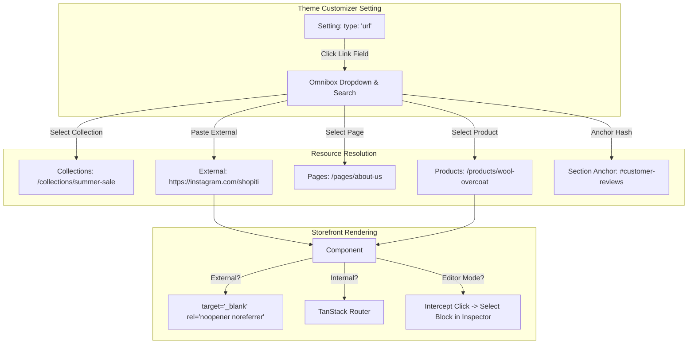

# Links & Navigation Architecture

> **A Complete Guide to Omnibox Link Pickers, Dynamic Resource Resolution, Navigation Menus, and Customizer Iframe Safety in Shopiti.**  
> Modeled after **Shopify URL Pickers & Navigation Menus**, engineered for **TanStack Router & React**.

---

## 1. Architectural Philosophy: Why Raw Text Links Fail

In basic editors, links are simple text fields where users manually paste URLs. In an enterprise e-commerce platform, this leads to significant vulnerabilities:

1. **Broken Links & Typos:** A typo like `/produts/jacket` results in a 404 error and lost sales.
2. **Handle/Slug Changes:** If an admin renames a product handle from `/products/shirt-v1` to `/products/oxford-shirt`, hardcoded strings break across dozens of banners and buttons.
3. **Security Vulnerabilities:** External links without `rel="noopener noreferrer"` expose users to reverse tab-nabbing attacks.
4. **Editor Shell Crashes:** Clicking an external link or unhandled route inside a customizer preview iframe can hijack the entire browser window and kick the merchant out of the visual customizer.

### The Shopiti Solution:

An **Omnibox Link Picker (`url` / `link_picker`)** that allows merchants to search internal catalog entities directly, paired with a safe navigation bridge in the Theme Customizer.



---

## 2. The Omnibox Link Picker (`url`)

When a merchant edits a setting with `type: 'url'`, clicking the input opens a categorized search dropdown:

```
Omnibox Link Picker
├── 🔍 Search products, collections, pages...
├── 📁 Collections      (All Collections, Summer 2026, Best Sellers)
├── 🏷️ Products         (Wool Overcoat, Classic Sneakers, Leather Wallet)
├── 📄 Pages            (About Us, Contact, FAQ, Sustainability)
├── 📰 Blog Posts       (Behind the Design, Spring Lookbook)
├── ⚖️ Store Policies   (Privacy Policy, Terms of Service, Refund Policy)
├── 🌐 External URL     (https://... with "Open in new window" toggle)
└── ⚓ Section Anchor   (#features, #reviews, #pricing)
```

---

## 3. The `UrlValue` Data Contract

The `url` setting type serializes into a structured `UrlValue` object (or a clean internal path string):

```ts
export interface UrlValue {
  /** Target destination path or full URL */
  url: string
  /** Window target: '_self' for internal, '_blank' for external */
  target?: '_self' | '_blank'
  /** Human-readable display title (e.g. 'Men's Footwear') */
  title?: string
  /** Resource entity type */
  type?:
    | 'product'
    | 'collection'
    | 'page'
    | 'blog'
    | 'article'
    | 'policy'
    | 'external'
    | 'anchor'
    | 'protocol'
}
```

### Schema Setting Definition:

```ts
{
  type: 'url',
  id: 'button_link',
  label: 'Button Link',
  info: 'Search for a product, collection, page, or enter an external URL.',
  default: '/collections/all',
}
```

---

## 4. Navigation Menus & Mega Menu Trees

Beyond single link settings, themes frequently render complex navigation structures (header dropdowns, mega menus, footer multi-columns).

### 1. The `menu` Setting Type

Rather than configuring dozens of individual link settings, the schema references a centralized store navigation menu:

```ts
{
  type: 'menu',
  id: 'main_menu',
  label: 'Main Navigation Menu',
  default: 'main-menu',
}
```

### 2. Multi-Level Menu Data Structure:

```json
{
  "id": "main-menu",
  "title": "Main Menu",
  "items": [
    {
      "id": "shop",
      "title": "Shop",
      "url": "/collections/all",
      "items": [
        {
          "id": "clothing",
          "title": "Clothing",
          "url": "/collections/clothing",
          "items": [
            {
              "id": "jackets",
              "title": "Jackets & Coats",
              "url": "/collections/jackets"
            },
            {
              "id": "knitwear",
              "title": "Sweaters & Knits",
              "url": "/collections/knitwear"
            }
          ]
        },
        {
          "id": "footwear",
          "title": "Footwear",
          "url": "/collections/footwear"
        }
      ]
    },
    { "id": "about", "title": "About", "url": "/pages/about" },
    { "id": "contact", "title": "Contact", "url": "/pages/contact" }
  ]
}
```

---

## 5. Customizer Iframe Click Safety & Event Interception

In the Theme Customizer, the center canvas runs inside an `<iframe>` to guarantee CSS and DOM isolation.

### The Critical Rule:

**Links clicked inside the customizer preview MUST NOT cause full page reloads or navigate out of the editor.**

In `src/routes/preview/-components/PreviewSectionWrapper.tsx`:

```tsx
export const StorefrontLink: React.FC<{
  to?: string | UrlValue
  children: React.ReactNode
  className?: string
}> = ({ to, children, className }) => {
  const isEditor = useIsEditor()
  const href = typeof to === 'string' ? to : to?.url || '#'
  const target = typeof to === 'object' ? to.target : undefined
  const isExternal = href.startsWith('http://') || href.startsWith('https://')

  const handleClick = (e: React.MouseEvent<HTMLAnchorElement>) => {
    if (isEditor) {
      // 1. In customizer mode, prevent browser from navigating away
      e.preventDefault()

      // 2. If it's an internal route, notify the parent editor to switch the active preview template
      if (!isExternal && href.startsWith('/')) {
        window.parent.postMessage(
          { type: 'PREVIEW_NAVIGATE_ROUTE', payload: { path: href } },
          '*',
        )
      }
    }
  }

  return (
    <a
      href={href}
      target={isExternal ? '_blank' : target || '_self'}
      rel={isExternal ? 'noopener noreferrer' : undefined}
      className={className}
      onClick={handleClick}
    >
      {children}
    </a>
  )
}
```

---

## 6. Supported Protocols & Anchor Tags

The link resolver supports special navigation protocols:

- **Section Anchor Jumping:** `#specifications` or `#reviews` smoothly scrolls to the section with the matching HTML ID.
- **Telephone Links:** `tel:+18005550199` opens the mobile phone dialer.
- **Email Links:** `mailto:support@shopiti.com?subject=Order%20Inquiry` opens the customer's mail client.
- **SMS Links:** `sms:+18005550199` opens mobile text messaging.
