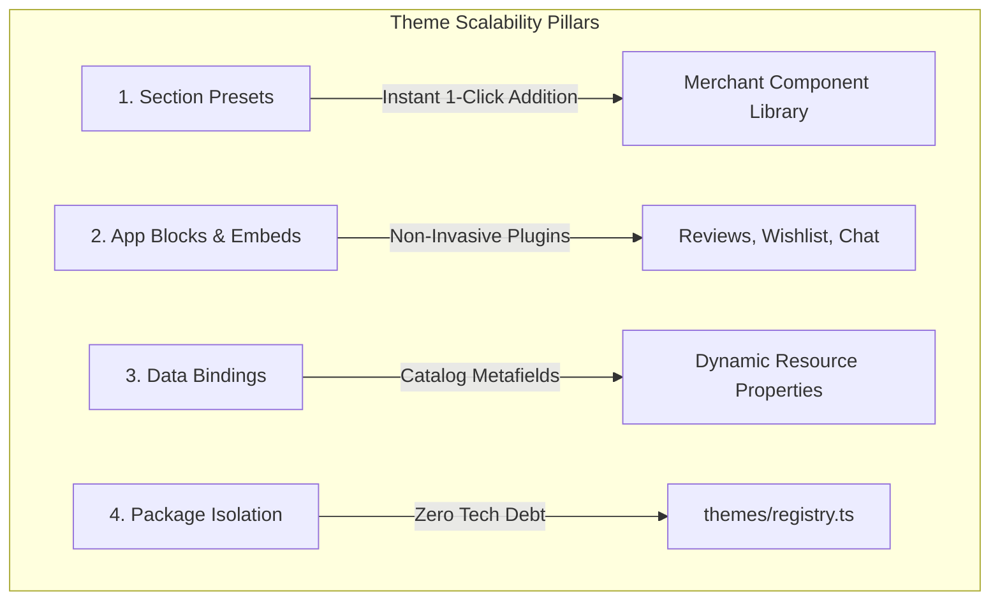
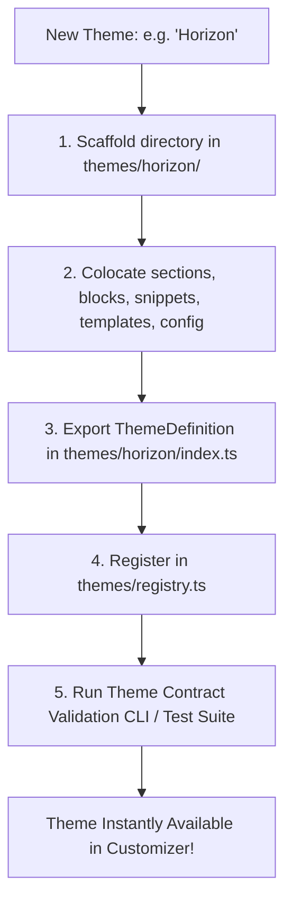

# Advanced Shopify-Inspired Patterns & Multi-Theme Scaling

> **A Strategic Guide to Presets, App Blocks, Dynamic Data Bindings, and Multi-Theme Governance in Shopiti.**  
> Designed to ensure scaling from 2 themes to 10+ themes happens with zero architectural technical debt.

---

## 1. Overview & Shopify OS 2.0 Innovations

Shopify's transition from legacy Liquid themes to **Online Store 2.0 (Dawn Architecture)** solved major architectural challenges that modern React headless builders also face:

1. **Section Presets:** Sections aren't blank canvases; they come pre-configured with stunning default layouts and demo blocks so merchants can build pages with one click.
2. **App Blocks & App Embeds:** Third-party extensions (reviews, wishlists, analytics, chat) inject modularly without modifying theme core files.
3. **Dynamic Data Sources (Metafields):** Settings can bind directly to backend catalog attributes rather than static text.
4. **Theme Package Isolation:** Strict sandboxing guarantees that creating a new theme never pollutes or breaks existing themes.



---

## 2. Section Presets & Block Defaults

### The Problem:
When a merchant clicks **"Add Section"** in the customizer, adding an empty section with zero blocks creates frustration and confusion. The merchant does not know what the section looks like or what settings to configure.

### The Solution:
Every section schema MUST declare one or more **Presets**. When a preset is selected from the library modal, the Theme Engine automatically:
1. Generates a new unique section instance ID.
2. Applies the preset's initial setting values.
3. Generates all child blocks specified in the preset with unique IDs and settings.

### Schema Implementation:
```ts
// themes/dawn/sections/testimonials/Testimonials.schema.ts
export const TestimonialsSchema: SectionSchema = {
  type: 'testimonials',
  name: 'Testimonials Slider',
  category: 'Promotional',
  settings: [
    { type: 'text', id: 'heading', label: 'Section Heading', default: 'What Our Customers Say' },
    { type: 'color_scheme', id: 'color_scheme', label: 'Color Scheme', default: 'scheme-2' },
  ],
  blocks: [
    {
      type: 'quote',
      name: 'Customer Review',
      settings: [
        { type: 'range', id: 'rating', label: 'Star Rating', min: 1, max: 5, default: 5 },
        { type: 'textarea', id: 'quote', label: 'Review Text', default: 'Outstanding craftsmanship and attention to detail.' },
        { type: 'text', id: 'author', label: 'Customer Name', default: 'Sarah M.' },
      ],
    },
  ],
  // Presets define the default state when added to a page:
  presets: [
    {
      name: '3-Column Customer Reviews',
      category: 'Promotional',
      settings: {
        heading: 'Trusted by Over 50,000 Customers',
        color_scheme: 'scheme-2',
      },
      blocks: [
        {
          type: 'quote',
          settings: {
            rating: 5,
            quote: 'The best investment I have made this year. Beautiful and durable.',
            author: 'Elena R. — Verified Buyer',
          },
        },
        {
          type: 'quote',
          settings: {
            rating: 5,
            quote: 'Exceptional build quality. Shipped faster than expected!',
            author: 'Marcus K. — Verified Buyer',
          },
        },
        {
          type: 'quote',
          settings: {
            rating: 5,
            quote: 'Customer support answered my questions within minutes. Highly recommended.',
            author: 'David L. — Verified Buyer',
          },
        },
      ],
    },
  ],
}
```

---

## 3. App Blocks & App Embeds (Theme Extensibility)

In high-growth e-commerce, stores install numerous apps: product reviews, size charts, live chat, loyalty rewards, and analytics.

### Why App Blocks Matter:
If app developers edit section code directly, updating the theme wipes out the app code, and uninstalling an app leaves orphaned zombie code.

### The Shopiti Architecture:
1. **App Blocks (In-Page):**
   Sections that support app integration (like `MainProduct` or `FeaturedProduct`) declare `@app` in their allowed blocks:
   ```ts
   // In ProductInformation.schema.ts
   blocks: [
     { type: 'title', name: 'Product Title', settings: [] },
     { type: 'price', name: 'Price', settings: [] },
     { type: '@app', name: 'App Block', settings: [] }, // Accepts any registered 3rd party app block
     { type: 'buy_buttons', name: 'Buy Buttons', settings: [] },
   ]
   ```
   A merchant can drag a **Judge.me Reviews Widget** or **Klaviyo Back-in-Stock Alert** directly between the Product Price and Buy Buttons!

2. **App Embeds (Floating / Global):**
   App Embeds are floating or headless widgets (e.g. Gorgias Chat Bubble, Cookie Consent Banner, Google Tag Manager). They are activated in the Theme Customizer under a dedicated **App Embeds** tab without modifying any section or template.

---

## 4. Dynamic Data Sources & Metafield Bindings

In modern Shopify themes, settings do not have to be static strings. A text setting can connect to a dynamic resource property (Metafield).

### Example Use Case:
A merchant wants a "Care Instructions" accordion on every product page. But each product has different care instructions!
- Without data bindings, the merchant would need a separate template for every single product.
- With data bindings, the accordion block setting is connected to `product.metafields.custom.care_instructions`. The same template dynamically resolves the unique care text for each product!

### Data Binding Syntax in Templates:
```json
{
  "type": "accordion_item",
  "settings": {
    "heading": "Fabric & Care Instructions",
    "content": "{{ product.metafields.custom.care_instructions }}"
  }
}
```

---

## 5. Multi-Theme Governance & Scaling Checklist

Currently, the workspace contains 2 themes: **Dawn** (B2C Commerce) and **Forge** (B2B Industrial). When adding Theme #3, #4, and #10, follow this governance protocol:



### Governance Invariants (Strictly Enforced):
1. **Self-Contained Theme Packages:**
   All components, schemas, templates, and config files for a theme MUST reside inside its theme directory (`themes/[theme-id]/`).
2. **Zero Cross-Theme Dependencies:**
   Theme A must NEVER import from Theme B (`themes/forge` importing from `themes/dawn` is strictly prohibited). Code that is shared across themes MUST be lifted to `themes/shared/`.
3. **App-Code Decoupling:**
   Core application code (`src/`) must ONLY import theme contracts and runtime values from the public `#themes` entry point (`themes/index.ts`). Deep imports into internal theme folders are rejected by ESLint.
4. **Preserve JSON Purity:**
   Template JSON files (`templates/*.json`) must remain pure data dictionaries. No React JSX, HTML tags, or inline styles are permitted in template files.
5. **Universal Preset Requirement:**
   Every section registered in a theme must export at least one preset in its `.schema.ts` file.
6. **Automated Schema Validation:**
   Run the theme test suite to verify that:
   - All section and block types match their schema `type` strings.
   - All setting IDs referenced in default presets actually exist in the schema's `settings` array.
   - All templates in `templateCatalog` parse without JSON syntax errors.
